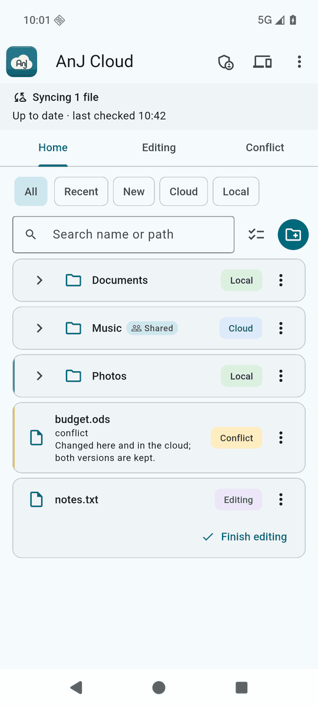
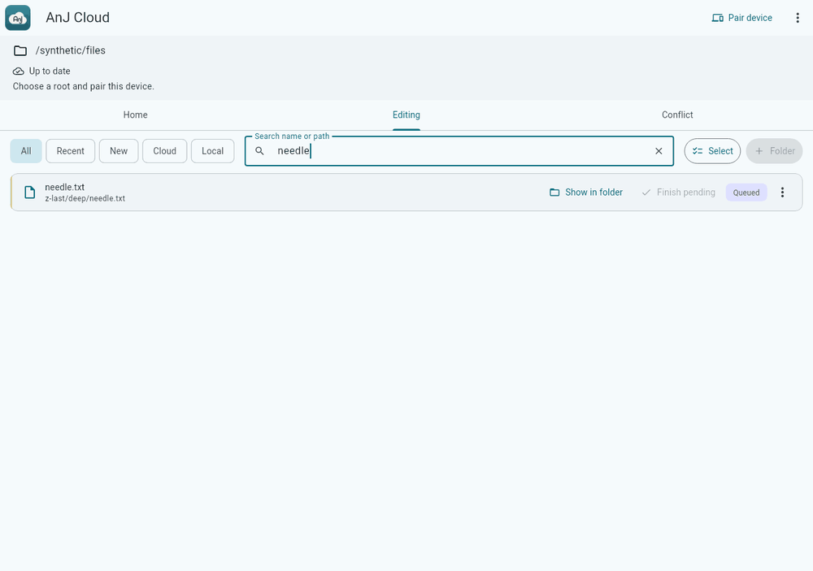
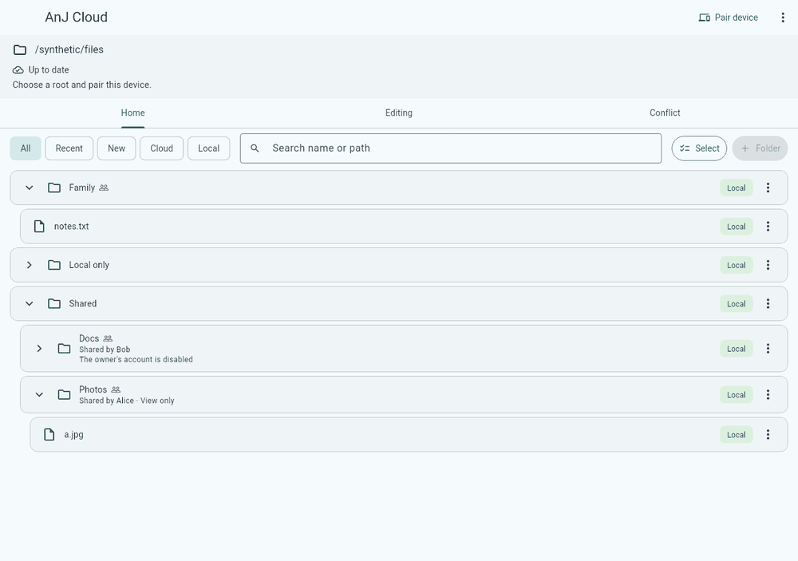
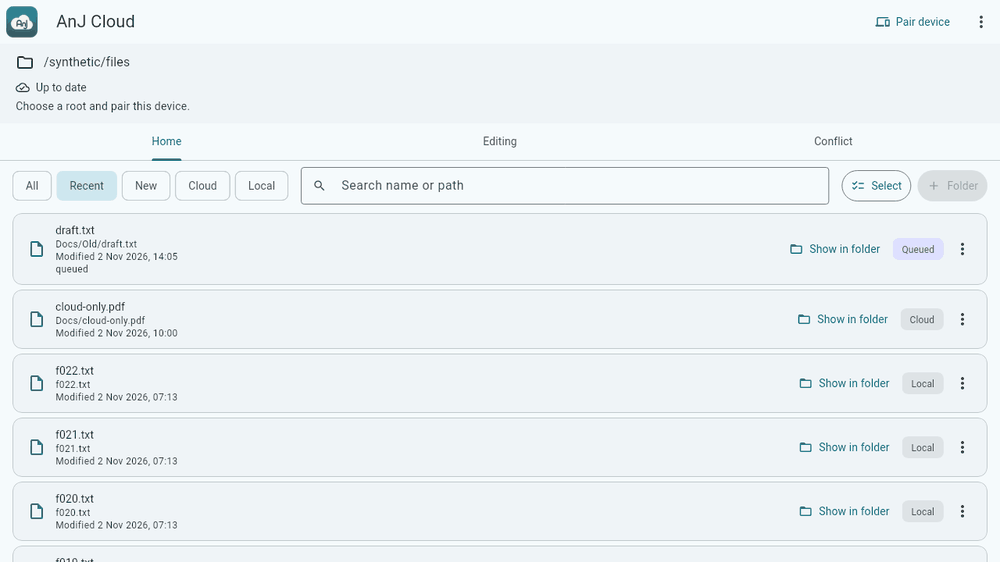
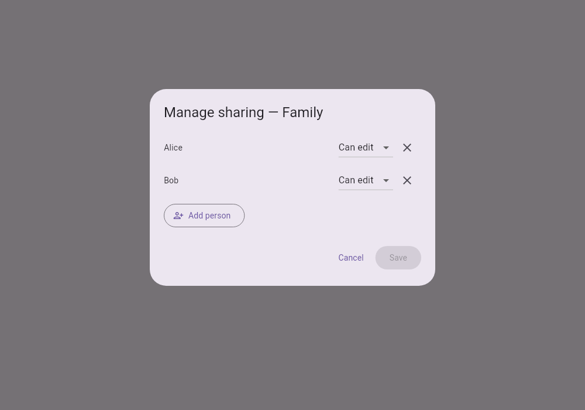

# AnJ Cloud

Household file sync and private inference access, from a gateway you host yourself. AnJ Cloud is built on
[Nextcloud](https://nextcloud.com/) for file storage and sharing, adding device pairing, per-device access control
and client updates. One small server at home, matching apps on Linux, macOS, Windows and Android, and one place to
say who and which devices may connect.



## What it does

- **Sync your files between your own devices.** Each device keeps a local folder in step with the household
  cloud. Folders can stay in the cloud and download only when opened, and local space can be freed without
  deleting anything remotely. Conflicts keep both versions.
- **Share folders inside the household.** An owner shares a folder with other household accounts, read only or
  editable, and the recipients see it as "Shared by ...".
- **Pair a device with a code.** An admin creates a one-time code (ten minutes). Typing it on a new device
  pairs it: the code also carries the pin of your household's certificate authority, so there is nothing else
  to install or trust by hand. Devices keep their own keys; an admin can revoke any device.
- **Update the apps from your own server.** The gateway serves each client's next release. Desktop releases are
  signed with a key you own; Android releases must carry your Android signing certificate.
- **Administer from the app.** Users, invitations, devices, settings, health and activity are in the Admin
  section for household admins.

| Library, search and filters | Sharing |
|---|---|
|  |  |

| Recent files | Managing who a folder is shared with |
|---|---|
|  |  |

## Status

AnJ Cloud is young software built for one household first.

| Platform | State |
|---|---|
| Gateway (Debian 13 amd64 VM or dedicated machine) | Guided installer tested in a Debian VM lab. **[Server quick start](docs/self-hosting/quickstart.md)** explains the validation limits. |
| Linux client (x86_64) | Usable: installer, tray, start at login, in-app update |
| Android client (arm64) | Usable: signed APK, in-app update |
| macOS client (Apple silicon) | Usable: installer, menu-bar item, in-app update |
| Windows client (x86_64) | Installer exists (install, update, run, start at login, uninstall); in-app updates for builds you sign and publish yourself, not yet verified on a Windows machine |

Inference access (routing paired devices to your own model gateway) is planned and is not part of this
repository yet.

## Set up your server first

Every client needs a gateway to pair with, so start there. The canonical
**[self-hosting quick start](docs/self-hosting/quickstart.md)** takes a generic Debian 13 amd64 VM or
dedicated machine through DNS, the guided installer, health checks, and first pairing. A VM is recommended
when the physical host has other uses.

You need 2 or more CPUs, 4 GiB RAM, 8 GiB free on the OS disk (20 GiB is the practical recommendation),
exactly one blank data disk, a public DNS hostname, and a router that can forward TCP 443. The installer
explains its detected defaults and asks for confirmation before formatting the data disk. No Subfloor,
Flutter, deployment profile, or client build/signing keys are needed.

Unattended Debian VM installs, synthetic-device access, and local upgrades have passed lab checks. The
complete interactive public walkthrough and real-network setup remain unverified; the quick start states
the exact tested commits and limits. Follow its stop conditions.

Read [requirements](docs/self-hosting/requirements.md),
[DNS, TLS and forwarding](docs/self-hosting/dns-tls-forwarding.md), and
[accounts and pairing](docs/self-hosting/accounts-and-pairing.md) alongside the quick start. The
[self-hosting index](docs/self-hosting/README.md) also identifies the separate advanced libvirt VM-host
route. The generic quick start does not configure backups; its limitations and next steps are explicit.

## Install a client

Download official Linux, macOS and Android builds, their `.sha256` files and `SHA256SUMS` from
[GitHub Releases](https://github.com/jedbjorn/anj-cloud/releases). You also need a pairing code from your
server's admin ([how to make one](docs/pairing.md)). Fuller instructions and build alternatives are in
[docs/clients.md](docs/clients.md).

Official builds carry the maintainer's keys: the Android APK is signed with the maintainer's APK signing key,
and the desktop apps embed the maintainer's Ed25519 update key (macOS builds are ad-hoc code-signed). They pair with any AnJ Cloud server: type your server
address in the editable **Server** field when pairing. The default `https://gateway.example.com` is a
placeholder. In-app updates only accept releases signed with those same keys, served by your paired gateway.
A household that wants its own update feed builds and signs its own clients
([keys and releases](docs/self-hosting/keys-and-releases.md)).

For desktop installation, obtain the install manager from this repository's reviewed source (the paths below
are relative to a source checkout). Replace the example filenames and `<hex>` with your release's filename
and SHA-256. Check the downloaded file against its checksum and the value on the release page before installing.

### Linux

Download the Linux x86_64 `.tar.gz` and its `.sha256`, then:

```bash
sha256sum -c '<archive>.tar.gz.sha256'
python3 apps/client/tool/linux_install.py install '<archive>.tar.gz' --sha256 <hex>
~/.local/bin/anj-cloud run
```

No root is needed. It installs under your home directory and adds a menu entry. A desktop keyring
(GNOME Keyring or KWallet) and tray host are needed (KDE has one; GNOME needs an AppIndicator extension).
Choose **Pair device**, enter your server address and code, then pick a local folder.
Building your own archive remains an [alternative](docs/clients.md#building-your-own-clients).

### macOS (Apple silicon)

Download the macOS arm64 `.zip` and its `.sha256`, then:

```bash
shasum -a 256 -c '<archive>.zip.sha256'
sh apps/client/tool/macos/anj-cloud-macos-install.sh install '<archive>.zip' --sha256 <hex>
```

No sudo is needed; it installs to `~/Applications`. The app is ad-hoc signed, without Apple notarization;
its in-app release verification trusts the maintainer's Ed25519 key. Open the app, choose **Pair device**,
and enter your server address and code. Building your own zip remains an
[alternative](docs/clients.md#building-your-own-clients).

### Windows (x86_64)

There is **no official Windows build yet**. An installer and update manager exist. A build you package with
your own release key updates itself in the app from your gateway, as on the other desktops; this is new and has
not been verified on a Windows machine yet. See [building and installing on Windows](docs/clients.md#windows).

### Android (arm64)

Download the release `.apk` and its `.sha256`, then check it on a computer:

```bash
sha256sum -c 'anj-cloud-<version>.apk.sha256'
# If using Android platform-tools with a connected phone:
adb install 'anj-cloud-<version>.apk'
```

On macOS use `shasum -a 256 -c` instead. Alternatively, transfer the checked APK to your phone and open it
(allow installs from that source). Choose **Pair device**, enter your server address and code (or scan its
QR code), and choose a folder. Android requires the same signing certificate for later updates.
Building and signing your own APK remains an [alternative](docs/clients.md#building-your-own-clients).

## Documentation

- [Overview and architecture](docs/overview.md)
- [Self-hosting the gateway](docs/self-hosting/README.md)
- [Installing the clients](docs/clients.md)
- [Pairing a device](docs/pairing.md)
- [Updates and release signing](docs/updates-and-signing.md)
- [Development and testing](docs/development.md)

## Contributing and security

See [CONTRIBUTING.md](CONTRIBUTING.md) and the [code of conduct](CODE_OF_CONDUCT.md). Report vulnerabilities
privately as described in [SECURITY.md](SECURITY.md).

## More projects

Other open-source projects by the same author:

- **[FAI Browser](https://jedbjorn.github.io/fai-browser/)** — lets a coding agent work in one browser tab you approve, with permission levels, secret redaction and compact page summaries. ([source](https://github.com/jedbjorn/fai-browser))
- **[Subfloor](https://subfloor.designs-os.com)** — a standing team of coding agents for your Git repository, with durable identity, memory, specs and handoffs, run through your coding harness. ([source](https://github.com/jedbjorn/subfloor))
- **[RST](https://jedbjorn.github.io/rst-c/)** — a native Revit add-in for curated ribbon profiles: admins build them, users load them with one click. ([source](https://github.com/jedbjorn/rst-c))
- **[Gantt-It](https://jedbjorn.github.io/gantt-it/)** — a Revit add-in that draws Gantt charts in your project, ready to place on sheets. ([source](https://github.com/jedbjorn/gantt-it))
- **[Splash-It](https://jedbjorn.github.io/splash-it/)** — a Revit add-in that colors view tabs by file, so open models and families are easy to tell apart. ([source](https://github.com/jedbjorn/splash-it))
- **[md-converter](https://md-converter.designs-os.com)** — a static web app that renders themed Markdown into styled, shareable HTML. ([source](https://github.com/jedbjorn/md-converter))
- **[Storybench](https://github.com/jedbjorn/storybench)** — a local workspace for developing videos with an AI production agent.
- **[Pick-It](https://jedbjorn.github.io/pick-it/)** — a Revit add-in that picks any colour on screen, shows its RGB values on the ribbon button and adds it to Revit's custom colours. ([source](https://github.com/jedbjorn/pick-it))

## License

Apache License 2.0, see [LICENSE](LICENSE) and [NOTICE](NOTICE).
