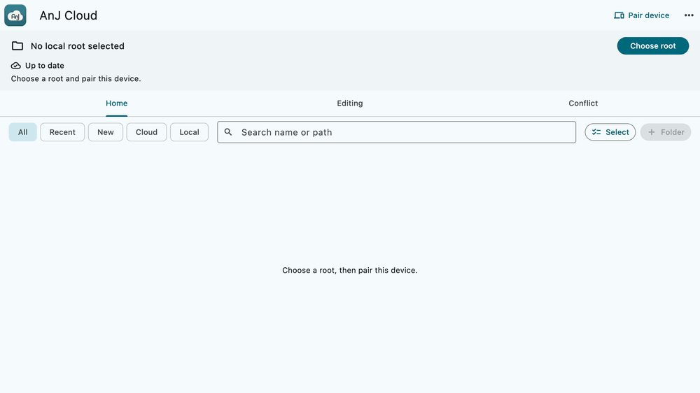
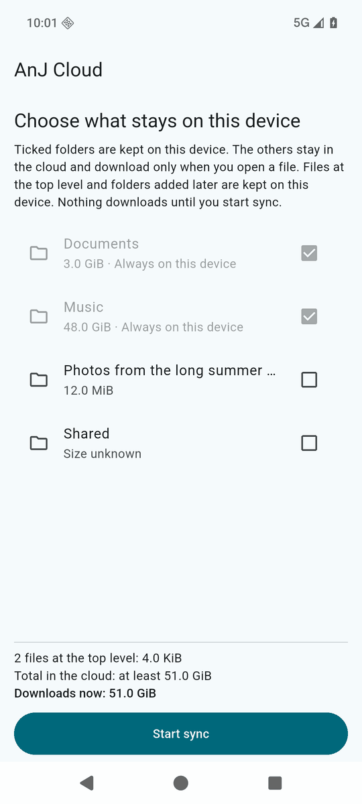

# Installing the clients

Official Linux x86_64, macOS arm64, Windows x86_64 and Android arm64 clients are available from
[GitHub Releases](https://github.com/jedbjorn/anj-cloud/releases). Download your artifact and its `.sha256`
file; compare the digest with the release page, then run the checksum command below. `SHA256SUMS` lists all
artifacts in the release. Replace the example filenames and `<hex>` with the downloaded filename and digest.

Official builds carry the maintainer's keys: the Android APK is signed with the maintainer's APK signing key,
and the desktop apps embed the maintainer's Ed25519 update key (macOS builds are ad-hoc code-signed; Windows builds are not code-signed). They pair with any AnJ Cloud server: type your server
address in the editable **Server** field at pairing. `https://gateway.example.com` is only the default text.
In-app updates are downloaded from your paired gateway and only accept releases signed with those same
keys (Ed25519 on desktop; the Android signing certificate on Android). A household that wants its own update
feed builds and signs its own clients; see [keys and releases](self-hosting/keys-and-releases.md).

Linux and macOS commands below use the install managers from this repository's reviewed source, relative to
the repository root. Obtain that source before installing; an archive checksum alone does not authenticate an
installer script. On Windows the manager is a program inside the zip, so there the zip itself must be checked
against the release page before anything in it is run.

| Platform | Official download | Install |
|---|---|---|
| Linux x86_64 | `.tar.gz` | `linux_install.py` |
| macOS (Apple silicon) | `.zip` | `anj-cloud-macos-install.sh` |
| Android (arm64) | Signed `.apk` | Open APK on phone, or `adb install` |
| Windows (x86_64) | `.zip` (early; tested on one Windows 10 machine) | `anj-cloud-manager.exe` from the zip |

## Linux

Download the Linux archive and checksum from [Releases](https://github.com/jedbjorn/anj-cloud/releases).
Needs a desktop session with a secret-service keyring (GNOME Keyring or KWallet) and a tray host
(KDE Plasma has one; GNOME needs an AppIndicator extension).

```bash
sha256sum -c '<archive>.tar.gz.sha256'
python3 apps/client/tool/linux_install.py install '<archive>.tar.gz' --sha256 <hex>
~/.local/bin/anj-cloud status
~/.local/bin/anj-cloud run
```

The app installs under your home directory (no root), adds a menu entry and the `anj-cloud` command,
starts hidden in the tray, and keeps syncing when the window is closed. Start at login is a toggle in the app.
`apps/client/LINUX_INSTALL.md` is the full reference for installation, updates and profiles.

## macOS

Download the Apple silicon zip and checksum from [Releases](https://github.com/jedbjorn/anj-cloud/releases).
Installing needs only base macOS tools:

```bash
shasum -a 256 -c '<archive>.zip.sha256'
sh apps/client/tool/macos/anj-cloud-macos-install.sh install '<archive>.zip' --sha256 <hex>
```

The manager installs into `~/Applications` without sudo and can enable start at login. The app is ad-hoc
signed, without Apple notarization; its in-app release verification trusts the maintainer's Ed25519 key.
See `apps/client/ARCHITECTURE.md` (macOS) for journaled swaps, launch checks and rollback.



## Android

Download the APK and checksum from [Releases](https://github.com/jedbjorn/anj-cloud/releases).
Check on a computer, then install with Android platform-tools if available:

```bash
sha256sum -c 'anj-cloud-<version>.apk.sha256'
adb install 'anj-cloud-<version>.apk'
```

On macOS use `shasum -a 256 -c` instead. Alternatively, transfer the checked APK to your phone and open it,
allowing installs from that source. Android accepts updates only with the same signing certificate.
The synced folder is chosen in shared storage, visible to file managers and other apps you authorize.

## Building your own clients

Building is an alternative to the official downloads. Set up your deployment profile with your default
server address and release keys ([self-hosting guide](self-hosting/README.md)). The address is editable at
pairing; the embedded release key determines which in-app updates the client accepts.

```bash
# Linux: clean committed source, pinned Flutter SDK and Docker:
python3 apps/client/tool/package_linux.py /absolute/absent/output-dir

# Android: pinned Flutter/Android toolchains; create your signing key once and back it up offline:
python3 apps/client/tool/android/release_android.py keygen
python3 apps/client/tool/android/release_android.py build /absolute/absent/output-dir

# macOS: from the Linux build host, over SSH to a configured macOS build host with Xcode and pinned Flutter:
bash apps/client/tool/macos/release_macos.sh HEAD /absolute/absent/output-dir
```

The packaging tools write checksums alongside the artifacts. Install with the same platform commands above.
Keep your signing keys safe; publish your signed updates through your gateway as described in
[keys and releases](self-hosting/keys-and-releases.md).

## Windows

Download the Windows x86_64 zip and its checksum from [Releases](https://github.com/jedbjorn/anj-cloud/releases).
The installer, `anj-cloud-manager.exe`, is inside the zip. A checksum cannot vouch for the program that checks
it, so first compare the zip's SHA-256 with the value shown on the release page yourself, in PowerShell:

```powershell
(Get-FileHash '<archive>.zip' -Algorithm SHA256).Hash.ToLower()    # must equal the release page's value
mkdir unpacked; tar.exe -xf '<archive>.zip' -C unpacked
$manager = (Get-Item unpacked\anj-cloud-windows-x86_64-*\anj-cloud-manager.exe).FullName
& $manager install '<archive>.zip' --sha256 <hex>
```

Run the manager as your normal Windows user; it refuses to run as administrator. It installs under
`%LOCALAPPDATA%\Programs\anj-cloud`, adds a Start menu entry and a Programs and Features entry, and starts the
app at login (hidden in the notification area). The unpacked folder can be deleted afterwards. Later:

```powershell
# the installed manager is beside the app, under %LOCALAPPDATA%\Programs\anj-cloud\releases\<release>\
anj-cloud-manager.exe status
anj-cloud-manager.exe autostart disable      # also: enable, status
anj-cloud-manager.exe update <zip> --sha256 <hex>   # by hand; quit the app first
anj-cloud-manager.exe uninstall              # removes exactly what install added; keeps your profile and files
```

The app keeps its secrets in Windows DPAPI and shows a notification-area icon. Pairing is as on the other
desktops. The official build updates itself in the app from your paired gateway, like the other desktops.

**How far this has been tested.** The Windows client is early. Everything below was run on one Windows 10
(19045) machine and nowhere else:

- the official zip itself: installed with its manager, started from the Start menu, the pairing screen shown
  with the default server address, quit, uninstalled;
- with test builds of the same code, a test key and a test gateway: pairing, sync, and the in-app update
  several times, including the refusal cases listed under "In-app updates" below, sign-out during an update,
  and a profile path with a space and non-ASCII letters;
- the project's Windows test scripts for the manager and the native library.

Not tested: Windows 11 or other Windows versions and machines; a profile path that is a short (8.3) or
redirected folder; the official zip paired with a real server and updated in the app (the first official
update will be the first time that path runs with the maintainer's key). The programs are not code-signed,
so Windows may warn about an unknown publisher when you run a downloaded file.

### Building your own Windows client

Building needs Windows x86_64 with Visual Studio Build Tools 2022 (C++ workload and C++ ATL) and the pinned
Flutter SDK (`apps/client/tool/windows/install.ps1` installs them on a build seat).

```powershell
# in apps\client, after `flutter build windows --release`:
powershell -File tool\windows\package.ps1 -SourceHead <40-hex commit>   # writes the zip and prints its SHA-256
#   add -VersionCode <n> -Version <v> for a build that updates itself in the app (see below)
```

Install it as above. `update <zip> --sha256 <hex>` refuses while the app runs.

**In-app updates.** An installed build offers **Update available** when all of these hold: it was built with
your release key in the tree (`apps/client/tool/apply_profile.py` writes it before `flutter build`), it was
packaged with `-VersionCode` and `-Version` (`python3 deploy/client_version.py <commit>` prints both for a
commit), and your gateway serves a newer `windows-x64` release signed with that key
(`python3 deploy/release.py publish --target windows-x64 --artifact <zip>`, see
[updates and signing](updates-and-signing.md)). A build without a release key or version shows no update
notices and is updated by hand.

On **Update now** the app quits and hands the download to the installed manager (`apply-update`). The manager
verifies the signature, size and SHA-256 again with the key inside the installed release, waits for the app to
have quit, installs the new release beside the old one and starts the app, which then shows **Updated to
version …**. Your profile, secrets and synced folder are not touched, and the release you were running is kept.

When the manager refuses an update, nothing is installed and the release you were running stays the active
one. What you see depends on why:

- The download does not match its signed size and SHA-256, another release was installed in the meantime, or
  another manager command was still running after two minutes: the manager starts the app again, and the app
  shows **Update could not be installed** with the reason.
- The app has not quit two minutes after **Update now**: the same message appears the next time the app
  starts. The manager starts it again itself only if the app quits within about five more minutes.
- The files of the update are changed or removed on disk while the manager waits (a security product
  quarantining one, for example): the manager checks them once more just before installing, refuses, starts
  the app again, and the app shows **Update could not be installed**.
- You start the app again yourself before the manager has installed the update: the manager gives up after a
  few seconds and leaves that instance alone. The reason is shown the next time the app starts, and the
  update is offered again.
- You sign out or shut down while it waits: nothing is installed and there is no message; the app offers the
  update again at its next start.

A release served by your gateway but signed with another key is never downloaded: the app shows **Update
could not be verified**.

The manager only accepts a download that lies in the profile folder it derives from `LOCALAPPDATA`. A profile
path with spaces or non-ASCII letters was tried; a short (8.3) or redirected `LOCALAPPDATA` was not. If the two
ever disagree the update is refused, nothing is installed, and updating by hand still works.

## The Downloader tab

When the server runs the fetch worker, every client shows a fourth tab, **Downloader**, after Conflict. Paste
one or more links (one per line), choose **Audio** (an `.m4a` with AAC audio, tags and cover art) or **Video**
(an `.mp4` with H.264 and AAC, **1080p** or **720p**), and press **Download**. The server downloads each item,
one at a time for the whole household, and saves it to your `Music` or `Videos` (a playlist into a folder
named after it, at most 200 items); your devices receive it by ordinary sync. Nothing is converted: a link
without a stream in those formats is refused with "This link has no format the Downloader supports yet."

Limits: an item longer than 4 hours or larger than 8 GiB is refused, at most 50 links per submit and 500
unfinished downloads per account, and nothing is accepted while the server's disk has under 10% free. Sites
that need a login, cookies or payment are not supported. Finished rows disappear after 7 days or with
**Clear finished**. You are responsible for having the right to download what you request. A server without
the worker shows no tab.

## First launch on any platform

1. Open the app, choose **Pair device**, and enter your server address and pairing code ([pairing.md](pairing.md)).
2. Pick a local folder as your root.
3. Choose which folders stay on the device on the first-sync screen, then **Start sync**.


