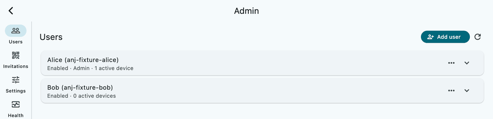

# Overview and architecture

AnJ Cloud has three parts: a **gateway** you host, **clients** on your devices, and **deployment tooling**
that builds and operates the gateway.

```text
 phone / laptop / desktop                     your home (or any Linux host)
 +----------------------+     HTTPS + mTLS    +-----------------------------------------+
 | AnJ Cloud client     | <-----------------> | VM (libvirt) running the gateway stack   |
 | - local folder       |   port 443 forward  |  HAProxy -> access gateway -> Nextcloud  |
 | - device key + cert  |                     |  (files), SQLite registry, backups       |
 +----------------------+                     +-----------------------------------------+
```

## The gateway

The gateway is the only thing exposed to the internet. It authenticates every request with a client
certificate that was issued when the device paired, and it speaks WebDAV to the files service behind it.

- **Access service** (`services/access/`): the device registry, certificate authority, pairing codes, the
  admin API, sharing, and the client release feed. State lives in a private SQLite registry.
- **Files:** a Nextcloud instance (with PostgreSQL and Redis) that holds the household's files. Neither is
  reachable except through the access service.
- **HAProxy** terminates TLS and enforces connection limits in front of the access service.
- **Fetch worker** (`services/fetch/`): downloads media a household member asks for (the client's Downloader
  tab) with yt-dlp and ffmpeg, one item at a time, and hands the checked file back to the access service,
  which saves it into that member's `Music` or `Videos` like an upload. It is the only container with
  outbound internet access; a network guard drops everything it sends to private, local or VM addresses, it
  runs without privileges, and it shares nothing with the other services except a spool volume.
- **PM2** supervises the services inside the VM; systemd handles boot and scheduled jobs.
- **Backups:** nightly encrypted backups to an attached drive, with a restore drill.
- **DDNS:** an optional updater keeps a Cloudflare DNS record pointing at your home address.

The whole stack runs in one VM on a Linux host, so the host stays clean and the VM can be rebuilt from its data
disk and the backups. See [self-hosting/README.md](self-hosting/README.md).

## Trust model

- A household has its own certificate authority. A pairing code carries the first 10 bytes (80 bits) of that
  CA's SHA-256, so a new device can check it is talking to your server before it trusts anything.
- Each device generates its own key. The gateway issues a certificate for it and records the device against an
  account. Revoking the device stops it at the next request.
- Admin is a role of an account, never of a device, and is re-checked on every admin request.
- Release updates are verified on the device: desktop manifests carry an Ed25519 signature checked against a key
  built into the app; Android updates must be signed with the installed app's certificate.



## The clients

One Flutter codebase (`apps/client/`) with platform adapters behind ports:

- the sync engine, local index and conflict handling are shared;
- platform code covers the root-folder boundary, the secret store, the tray or menu-bar item, start at login,
  and the installer or package manager of each platform;
- the architecture notes are in `apps/client/ARCHITECTURE.md`.

## Repository map

| Path | What is there |
|---|---|
| `apps/client/` | The Flutter client, installers and platform tooling |
| `services/access/` | The access service (device registry, CA, admin, sharing, releases) |
| `deploy/` | Dev stack, production stack tooling, bootstrap, backups, DDNS, release tools |
| `deploy/host/` | Host-side VM management scripts and units |
| `deploy/vm/` | Everything that runs inside the VM, including the guided installer |
| `tests/` | Python tests for the gateway and the deployment tooling |
| `docs/` | These documents |

## Deployment profile

Anything that belongs to one household (domain, addresses, account names, release key, Android signer pin) is
read from a deployment profile and not from the code. See `deploy/profile.example.toml` and
[self-hosting/README.md](self-hosting/README.md).
