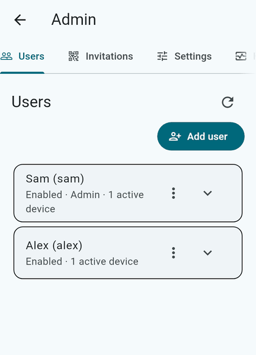
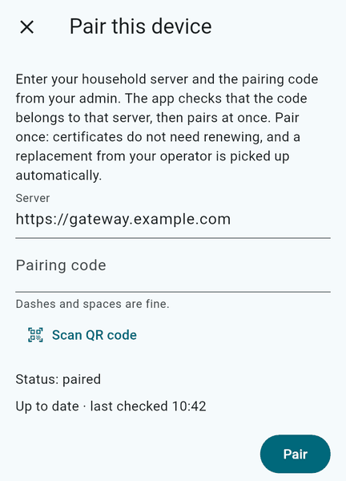

# Pairing a device

Pairing gives a device its own key and certificate and ties it to a household account. It happens once per
device.

## Admin: make a code

- In the client, open **Admin**, then **Invitations**, choose the account (or **Add user** first), and create a
  code. It can also be shown as a QR code.
- Or on the VM: `anj-cloud-admin invite --user <account>`; for the very first device,
  `sudo anj-cloud-setup pair`.

A code is random, single use, and valid for ten minutes. It also carries the first 16 bytes of the SHA-256 of
your household certificate authority.

## Device: enter it

1. Install the client ([clients.md](clients.md)) and open it.
2. Choose **Pair device**. The server field holds the address the app was built with; change it to your
   gateway's address, for example `https://gateway.example.com`.
3. Type the code (case does not matter; spaces and dashes are fine) or scan the QR code.
4. The app fetches your CA without trusting it, accepts it only when its SHA-256 matches the code ("This code
   is not for this server" otherwise, and nothing is stored), generates its key, and receives its certificate.
   A device is approved at once when it redeems a valid code.
5. Choose a local root folder and, on the first sync screen, which folders stay on this device. Nothing is
   downloaded until you start sync.

## Afterwards

- Certificates do not need renewing.
- An admin can see every device of an account and revoke one. A revoked device is refused on its next
  request.
- If a device loses its key, the app offers a reset; pair again with a new code.
- Pairing and updates need your gateway to be reachable from the device; on another network, forward port 443
  and use your public host name ([self-hosting/README.md](self-hosting/README.md)).
