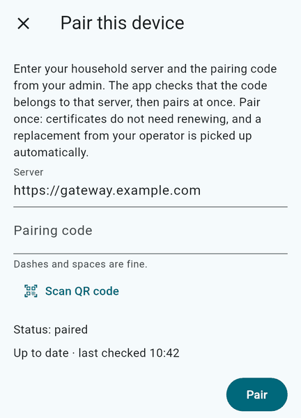

# Accounts and pairing

The guided install creates the account list you enter. **The first account becomes the first household
admin**; admin is a role of an account, not of a device. Account names are 1–32 lowercase letters, digits,
or `-`, start with a letter, and must be distinct.

Install the server with the [quick start](quickstart.md) before pairing. Install an
[official client](../clients.md) on the device; no Flutter toolchain or client build/signing keys are
needed.

## Pair the first admin device

For a complete remote-access check, use a phone on mobile data or a laptop on a hotspot. This avoids
mistaking a LAN-only or hairpin-NAT path for a working public server.

1. Inside the server, either use the pairing phase offered at the end of installation or run:

   ```bash
   sudo anj-cloud-setup pair
   ```

   Open the app before asking setup to issue the code. Setup prints the code once and can render a QR code
   on the terminal. A code is **single-use and valid for ten minutes**. It authorizes one device to join as
   the named account; do not save it, paste it into a log, or include it in a screenshot or issue.

2. In the app, choose **Pair device** and enter:

   | Field | Value |
   |---|---|
   | Server | `https://cloud.example.com`, replaced with your exact public hostname |
   | Code | The newly printed pairing code, or scan the terminal QR code when available |

   The server's default `gateway.example.com` text is only a placeholder. Use `https://`, no explicit port,
   and no path. Dashes and spaces in a typed code are accepted.

   

   This existing example image shows the placeholder `gateway.example.com`; replace it with your own server
   address.

3. The app fetches the household CA and accepts it only when the first 16 bytes of its SHA-256 fingerprint
   match the pin carried in the code. It generates a device-specific key and receives a certificate tied to
   the account. Redeeming a valid current code approves the device automatically; no CA file or separate
   trust store is installed by hand.

4. Wait for the server to print `Paired: <account>'s device …`. The app's **Admin** section appears for the
   first admin. Follow the app's choices for the local root folder and which folders to keep on the device.
   A successful outside-LAN pairing is the quick start's end-to-end network check.

If the code was already shown and is still valid, `pair` offers to wait for it rather than displaying it
again. If it was lost or expired, replace it:

```bash
sudo anj-cloud-setup pair --new-code
```

Replacing a live code invalidates the old one. Ctrl-C stops waiting without requiring you to discard the
server; run `sudo anj-cloud-setup pair` to resume.

## Stop instead of forcing a pairing

- If the app says **“This code is not for this server”**, check the server URL and that the code came from
  this server. Do not disable certificate or hostname verification.
- If a code is refused or expired, issue a new one. Do not reuse a code for another device.
- If a device or enrollment request is unexpected, do not approve it. Revoke an already paired device in
  **Admin**, or with `anj-cloud-admin revoke <device-id>` as `anj` inside the server.
- If outside-LAN pairing cannot reach the server, check public DNS, public IPv4/CGNAT, and the single
  TCP 443 forward. If only LAN access fails, check hairpin NAT or split DNS. See
  [DNS, TLS and forwarding](dns-tls-forwarding.md).
- If the server is not healthy, run `sudo anj-cloud-setup doctor` and resolve its findings before creating
  more codes.

## Add people and more devices

Day to day, use the admin client's **Admin** section for users, invitations, devices, settings, health, and
activity. Create a user if needed, choose that account in **Invitations**, and issue a new code for each
device. Pair every device to its owner's account; do not share the first admin's code around the household.

Each paired device has its own key and certificate. Revoking one device does not require changing the
household CA or re-pairing every other device. A server configured for alerts sends a new-device alert;
that alert is useful only if the ntfy path and phone subscription are working.

## Recovery CLI inside the server

When no admin client is available, use `anj-cloud-admin` **as `anj` inside the server**. It talks to the
same gateway administration path, including its last-admin safeguards and audit logging. Destructive
commands ask for typed confirmation.

```bash
anj-cloud-admin users
anj-cloud-admin admins
anj-cloud-admin devices
anj-cloud-admin health

anj-cloud-admin user-add alex --name Alex
anj-cloud-admin admin-grant alex
anj-cloud-admin invite --user sam
anj-cloud-admin revoke <device-id>
```

`invite` prints a one-time code and, on a terminal, a QR code. Replace `sam`, `alex`, and the device ID with
real values from the account/device lists. To recover access for the last admin, invite a new device for
that admin account and pair it normally. If no enabled admin remains but another account should receive
the role, `admin-grant <account>` is the recovery operation.

Do not pipe invitation output into logs or issue reports.

## Verify the result

Inside the server:

```bash
anj-cloud-setup status
sudo anj-cloud-setup doctor
```

Expect `Healthcheck     ready` and `doctor: all checks pass`. `anj-cloud-admin users` and
`anj-cloud-admin devices` should show the intended accounts and paired device. These local checks complement
rather than replace a successful client pairing from outside the LAN.

Backups remain a separate requirement. A paired device and an ntfy test do not demonstrate that a backup
exists or can be restored; see the generic path's
[backup and alert limitations](quickstart.md#6-what-is-configured-and-what-is-not).
