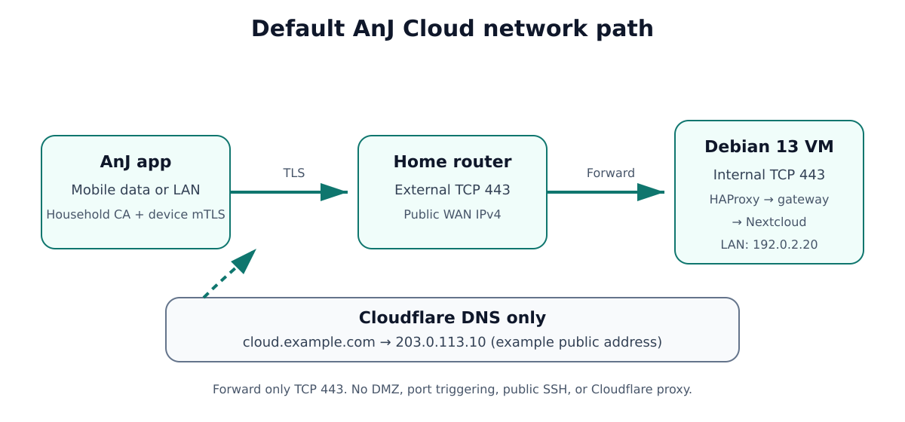
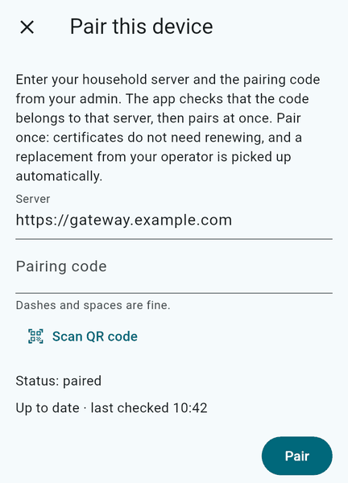

# Quick start: a working AnJ Cloud server

This is the canonical installation path for a new self-hosted server. It uses one generic **Debian 13
amd64** machine, the guided installer from the public checkout, and an official AnJ Cloud client. It does
not require Subfloor, Flutter, a client build, a deployment profile, or client signing keys.

> **Validation status (2026-11-07):** fresh Debian 13 amd64 lab installs passed at `006a642e` with umask
> `022` and `49702e44` with umask `077`, including status, doctor, and production checks. Final installer
> code `9e299cfa` passed a full permission-repair rerun on an existing installation and a real local
> upgrade; a fresh install was not repeated at that commit. Lab runs also verified synthetic first-device
> pairing through HAProxy on TCP 443 and authenticated mTLS DAV writes and reads.
>
> Testing used unattended answers, cloud-init account/SSH provisioning, a local Git remote fixture, DDNS
> off, no ntfy receiver, and no backup share. The complete interactive walkthrough, deployment from GitHub
> main, real Cloudflare/DDNS, router forwarding, outside-LAN official-client pairing, hairpin/split DNS,
> phone-alert delivery, and backup/restore remain unverified. Stop on an unexpected disk, prompt, or error
> rather than improvising a workaround.

When you finish, you will have a healthy Nextcloud-backed AnJ Cloud server, a public hostname, one router
forward, and a first device paired to the first household admin. **This path does not configure backups.**

## 1. Prepare the machine

Use a VM when the physical host has other uses. A dedicated machine is also supported. In either case,
AnJ Cloud needs TCP port 443 and refuses other Docker containers that publish ports.

Before starting, have all of the following:

- Debian 13 (trixie), amd64; at least 2 CPUs and 4 GiB RAM.
- At least 8 GiB free on the OS filesystem (`/`). A 20 GiB OS disk is a practical recommendation.
- Exactly one separate, blank data disk, sized for the household's files. Attach only the OS disk and this
  data disk for the initial install; extra unmounted disks can make setup refuse automatic selection.
- A sudo-capable user named `anj` and synchronized time.
- A fixed or DHCP-reserved LAN IPv4 address for the server, and outbound HTTPS.
- A fixed or DHCP-reserved LAN IPv4 address for the one computer allowed to administer the server over SSH.
- A domain and a public DNS hostname. This guide uses `cloud.example.com`; replace it everywhere with your
  own full hostname.
- A public WAN IPv4 address and access to the router's port-forwarding settings.
- For the guided install, a phone with the [ntfy app](https://ntfy.sh) for server alerts.
- For Cloudflare DDNS, the zone ID and a zone-scoped **Edit zone DNS** API token. Have an official client
  from [GitHub Releases](https://github.com/jedbjorn/anj-cloud/releases) ready for the first device too.

The full checklist is in [Requirements](requirements.md). DNS and token instructions are in
[DNS, TLS and forwarding](dns-tls-forwarding.md).

### Create and log in as `anj` if needed

Prefer creating `anj` during Debian installation and giving that account sudo access. A cloud image may
instead give you only root or a different OS account; do not assume `anj` already exists.

From an existing **sudo-capable** session, check for the account, create it only if absent, add it to the
sudo group, and start a fresh login as `anj`:

```bash
id anj
sudo adduser anj        # skip this command if id anj shows the account already exists
sudo usermod -aG sudo anj
su - anj
sudo -v
```

`adduser` prompts you to set the new account's password and profile details. The fresh `su - anj` login picks
up the new group membership; `sudo -v` must succeed before you continue. If you started from a **root**
shell, omit `sudo` from the `adduser` and `usermod` commands. If that root shell does not have sudo installed,
install it first with `apt-get update && apt-get install -y --no-install-recommends sudo`.

Do not run the remaining installation as root or under the image's other OS account. Run the rest as `anj`,
using `sudo` only for the commands that show it.

Run these checks **inside the VM or on the dedicated machine**, as `anj`:

```bash
id -un
sudo -v
timedatectl show -p NTPSynchronized --value
lsblk -o NAME,PATH,SIZE,TYPE,FSTYPE,LABEL,UUID,MOUNTPOINTS,MODEL
df -h /
```

Expected results:

- `id -un` prints `anj`; `sudo -v` succeeds.
- `timedatectl` prints `yes`. If it does not, enable time sync with `sudo timedatectl set-ntp true` and wait
  until it synchronizes.
- The OS disk contains the `/` mount. The intended data disk is a separate whole disk with no mounted
  filesystem, partitions, filesystem type, or label. Its device might be `/dev/vdb` or `/dev/sdb`; do not
  assume a name from this example.
- `/` has at least 8 GiB available.

**Stop here** if the machine does not meet these checks, if you cannot identify the data disk with
certainty, or if that disk contains anything you might need. Use a new blank disk rather than wiping a disk
as part of this quick start.

## 2. Create the public name and forwarding rule

Decide the public hostname before installation. Setup writes it into the server certificate and will not
change it on an existing data disk later.

1. Add `example.com` to your DNS provider. Cloudflare's free DNS plan is recommended when using the built-in
   DDNS updater; buying or transferring the domain through Cloudflare is optional. If Cloudflare hosts the
   zone, set the nameservers it assigns at your registrar and preserve any unrelated DNS records.
2. Create exactly one **A record** for `cloud.example.com`, pointing to the router's **current public WAN
   IPv4**, not the server's LAN address. In Cloudflare, choose **DNS only** (the grey cloud), not Proxied.
3. For Cloudflare DDNS, copy the zone ID and create an API token from the **Edit zone DNS** template, limited
   to the `example.com` zone. DDNS updates this existing record; it does not create it.
4. On the router, forward **external TCP 443** to **internal TCP 443** at the server's fixed LAN IPv4
   address. In the advanced libvirt VM-host route, forward to the VM host instead; that host forwards to the
   VM. Do not enable DMZ or port triggering, and do not forward SSH.
5. Confirm that the WAN address is a public IPv4 address that the ISP routes to this router. Carrier-grade
   NAT (CGNAT) prevents this inbound path. If the router's WAN address is private/shared or does not match
   the public address seen by outside services, stop and ask the ISP for a publicly routed IPv4 address.

The supported and qualified server/router deployment forwards **external TCP 443 to internal TCP 443**.
Standard HTTPS therefore needs no port in the client URL. Alternate external ports are not documented,
supported, or qualified for this deployment; do not substitute a random external port as a security measure.

Cloudflare's orange-cloud proxy and ordinary Cloudflare Tunnel are **not supported** by this installation.
A future tunnel option for CGNAT requires a separately qualified design because current clients pin the
household CA and connect with direct per-device mutual TLS. See [the networking reference](dns-tls-forwarding.md)
for the details and official Cloudflare documentation.



## 3. Run the guided installer

Run all of these commands **inside the VM or on the dedicated machine**, from an interactive terminal as
`anj`. A fresh Debian 13 cloud image can have `curl` but not `git`, so install Git before cloning. The
`sudo` commands will ask for `anj`'s password if needed.

```bash
sudo apt-get update
sudo apt-get install -y --no-install-recommends git
git clone https://github.com/jedbjorn/anj-cloud.git
cd anj-cloud
git archive --format=tar --output=/tmp/anj-cloud-source.tar HEAD
sudo deploy/vm/anj-cloud-setup --source /tmp/anj-cloud-source.tar
```

The `git archive` step creates a source tar carrying the checkout's commit ID, which the installer requires.
The installer first checks the OS, architecture, CPU, RAM, free OS space, `anj` user, disks, DNS, outbound
HTTPS, port 443, time synchronization, and Docker port conflicts. It does not install packages, format a
disk, or change service configuration before the install review. A successful check prints:

```text
Checking this machine …
  ready ✓
```

### Answer the prompts

On a fresh public checkout, review these values rather than accepting placeholders:

| Prompt | What to enter |
|---|---|
| **Public hostname** | Replace `gateway.example.com` with your full hostname, such as `cloud.example.com`. A changed value is typed twice. |
| **Turn DDNS on?** | The interactive default is **on**. Keep it for Cloudflare DDNS; answer no when maintaining the A record yourself, including at another DNS provider. |
| **Cloudflare zone ID** | Replace the 32-zero placeholder with the zone's real 32-hex-character ID. This appears only with DDNS on. |
| **Cloudflare API token** | Paste the zone-scoped token at the hidden prompt, then repeat it. Setup performs a read-only check of the token, zone, and exact A record. If that check fails, stop and fix it instead of continuing knowingly. A `PROXIED` warning is also a stop: set the record to DNS only. |
| **Alert topic for your phone (ntfy)** | The usual generic-machine choice is **Create a new topic**. You can instead enter an existing private topic twice. Treat the topic like a password. Setup shows how to subscribe and sends a test alert; confirm it on your phone. |
| **Accounts** | Replace the sample names. Use lowercase letters, digits, and `-`, starting with a letter. **The first account becomes the household admin** and pairs the first device. |
| **Home network** | Replace `192.168.0.0/24` if your router uses a different private IPv4 range. This range receives the higher local connection limits. |
| **Address to serve on (port 443)** | The default is detected from the server's active IPv4 route. Keep it only when it is the server's fixed LAN address to which the router forwards. |
| **Only address allowed to log in by SSH** | Enter the admin computer's fixed LAN IPv4. Over SSH, setup suggests the current client address and warns before a mismatch can lock you out. Do not enter the router's address. This is a LAN firewall rule, not public SSH exposure. |
| **Time zone** | Keep the detected IANA time zone, or enter another such as `Europe/Paris`. |

Setup makes a read-only Cloudflare request when DDNS is on and may send an ntfy test message. Secrets are
entered at hidden prompts and are not put in command arguments or the setup evidence log.

### Review twice before installation and formatting

The **Ready to install** review shows the hostname, DDNS, accounts, alerts, LAN, bind address, SSH source,
time zone, and data disk. Check every line. Choose **Start installing?** only when all of them are right.

If the data disk is blank, setup then prints its device, size, and model and asks:

```text
Format <DATA_DISK> as the anj-cloud data disk? This erases it. [y/N]:
```

The default is **No**. Type `y` only if this is exactly the blank disk you identified in step 1. Setup
refuses mounted disks, disks with partitions or any detected signature, and disks whose safety probes fail.
It checks again immediately before formatting. These safeguards do not replace your own device review.

After confirmation, setup:

- formats the data disk as ext4 with the label `ANJ_DATA` and mounts it at `/srv/anj-cloud`;
- installs and configures Docker and PM2, placing Docker's data on the data disk;
- installs a firewall that accepts HTTPS to the configured bind address and SSH only from the configured
  admin source, with other unsolicited inbound TCP connections dropped;
- builds and starts Nextcloud and the AnJ Cloud gateway, creates the household CA and server certificate,
  and creates the accounts with the first account as admin;
- configures local health monitoring, ntfy alerts, optional DDNS, and Debian security updates; and
- verifies each step. A later re-run keeps finished steps and reports work already done instead of blindly
  repeating it.

Each progress line should end in `done ✓` or `already done`. If setup stops, read its fix. Use
`sudo anj-cloud-setup doctor` once that command exists; before then, run
`sudo deploy/vm/anj-cloud-setup doctor` from the checkout. Do not retry past a disk warning or disable a check.

## 4. Check the server

A successful installation prints `anj-cloud is installed and healthy.` with **Server: ready** and
**Firewall: on**. The DDNS line says either `off` or that it checks every five minutes. A DDNS process shown
as stopped between its periodic runs is normal.

Then run, still inside the machine:

```bash
anj-cloud-setup status
sudo anj-cloud-setup doctor
```

Expected results include `Healthcheck     ready` in status and:

```text
doctor: all checks pass
```

On this generic path, a summary warning that backups are not possible because no backup drive/share is
attached is expected. It is **not** a backup success message; see step 6.

For an independent network test, pair from outside the LAN in the next step. A web browser is not the health
check: this service uses a private household CA and per-device client certificates, not a public browser
login page. An optional JSON health check with the repository's tooling is documented in
[DNS, TLS and forwarding](dns-tls-forwarding.md#check-the-public-path).

## 5. Pair the first device

Use the first admin account's device. For the clearest end-to-end test, put that device on mobile data or
connect a laptop through a phone hotspot so it reaches `cloud.example.com` from outside the household LAN.

1. Install an [official client](../clients.md). No client build or signing key is needed to pair an official
   build with your server.
2. The installer offers pairing last. If you deferred it, run `sudo anj-cloud-setup pair` inside the
   machine. Open the app before asking setup to issue the code.
3. In the app, choose **Pair device** and enter:
   - **Server:** `https://cloud.example.com` (your hostname, with no port or path)
   - **Code:** the one-time code just printed by setup, or scan its terminal QR code when available
4. Use the code promptly. It is single-use and valid for ten minutes. Do not save it, log it, or send it to
   anyone else. For a replacement, run `sudo anj-cloud-setup pair --new-code`; this invalidates the old code.
5. The app fetches the household CA but accepts it only when its fingerprint matches the pin carried by the
   code. It then creates the device's own key and receives a per-device certificate. Do not disable TLS
   verification or install an unrelated CA to make pairing work.



Expected server output is `Paired: <account>'s device …`. The app's **Admin** section appears for the first
admin. Follow the app's remaining folder and sync choices. Pairing successfully from mobile data or a
hotspot proves public DNS, the TCP 443 forward, household TLS, and device enrollment together.

See [Accounts and pairing](accounts-and-pairing.md) for more devices, recovery commands, and stop
conditions.

## 6. What is configured, and what is not

- **More people and devices:** use the first admin client's **Admin** section to create users and
  invitations. Admin is an account role, not a property of the first device.
- **Alerts:** local monitoring and DDNS can send alerts through ntfy. Subscribe the phone, keep the topic
  private, and confirm the test. These alerts depend on the server, its network, ntfy, and the phone; they
  cannot report every power, router, ISP, or total server failure. No independent external monitor is
  configured here.
- **Backups:** the single data disk is not a backup, and this generic quick start does not attach or
  initialize the backup share used by the existing libvirt VM-host workflow. Do not assume scheduled units
  or an alert topic mean that restorable backups exist. A separate backup target and a tested restore are
  still required before relying on this server for irreplaceable data. The existing
  [backup workflow](backups.md#scope-the-existing-workflow-is-advanced-only) is advanced-only, not a generic
  same-disk workaround.
- **Server upgrades:** the generic route is `python3 deploy/vm/local_upgrade.py` from a fast-forwarded,
  clean public clone. See [Upgrades](upgrades.md) for the successful lab checks and their limits. The
  quick-start path has no pre-upgrade restore point.
- **Ongoing checks:** use `anj-cloud-setup status` and `sudo anj-cloud-setup doctor`. If something looks
  wrong after go-live, remove or disable the router forward first, then investigate. See
  [Troubleshooting](troubleshooting.md); the networking reference also documents the persistent emergency stop.

If anything differs materially from the expected output above, stop and report the command, step, and
redacted error. Never publish the Cloudflare token, ntfy topic, pairing code, private keys, or real household
addresses in an issue.
