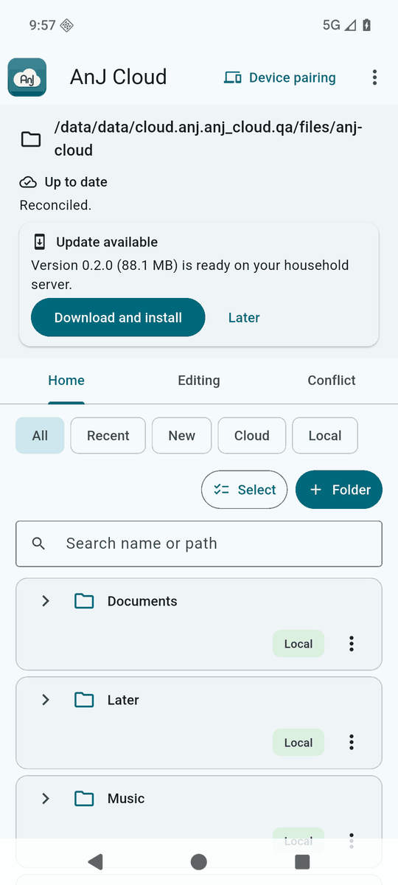

# Updates and release signing

Your gateway serves each client's next release, and clients check it over their own authenticated connection.
Nothing is trusted because it came from the network: every release is checked on the device against a key or
certificate that you control.



## How a device decides

| Platform | What it checks |
|---|---|
| Linux, macOS, Windows (desktop) | An Ed25519 signature over the release manifest, by the key built into the running app (`key_id` is the first 16 hex characters of that key's SHA-256); the manifest's target, version code (must be higher), size and SHA-256 against the downloaded archive |
| Android | The APK must be signed with the same certificate as the installed app (Android enforces this); the app also checks the package's size and SHA-256 and the manifest's signer against the one it carries |

Windows follows the desktop row, with no official build: it has been run end to end on one Windows 10 test
machine with test builds (see [Windows](clients.md#windows)).

A device whose app was built without your key shows no update notices at all. Updates wait for pending uploads
and for files being edited; the person chooses **Update now** or **Later**.

## Create your keys (once)

```bash
python3 deploy/release.py keygen
python3 apps/client/tool/android/release_android.py keygen
```

Both print only public facts: the desktop key id and public key line, and the Android certificate SHA-256. Put
them in the `[release]` section of your deployment profile (`public_key`, `key_id`, `android_signer_sha256`).
The private desktop key lives in `~/.local/share/anj-cloud/release-key/` and the Android keystore in
`~/.local/share/anj-cloud/signing/android/`; keep an offline copy of each and never put them in the
repository, the VM or a chat.

Builds read the profile through `apps/client/tool/apply_profile.py`, which writes the public key file and the
default server address into the build tree. Those files are generated and untracked.

## Publish a release

```bash
# Linux
python3 apps/client/tool/package_linux.py /absolute/absent/dir
python3 deploy/release.py publish --target linux-x86_64 --artifact /absolute/absent/dir/anj-cloud-linux-x86_64-<commit>.tar.gz --dry-run
# macOS: tool/macos/release_macos.sh <commit> <out>   then   release.py publish --target macos-arm64 --artifact <zip>
# Windows (on a Windows build machine; run end to end on one test machine only, see clients.md#windows):
#   tool\windows\package.ps1 -SourceHead <commit> -VersionCode <n> -Version <v>
#   then   release.py publish --target windows-x64 --artifact <zip>
# Android
python3 apps/client/tool/android/release_android.py build /absolute/absent/dir
python3 deploy/release.py publish --target android-arm64 --artifact /absolute/absent/dir/anj-cloud-<version>.apk
```

`publish` refuses unless the release's commit is on `origin/main`, the version code is higher than the served
one, the artifact trusts the key that signs it, and that key's id equals `key_id` in your profile (Android: the
APK's certificate equals `android_signer_sha256`). Use `--dry-run` first.

## Rotation

No command rotates a key and there is no remote revocation: every installed app keeps trusting what it was
built or installed with. Rotate only when a key is lost or may be known to someone else; the steps for the
desktop key and the Android certificate, and what each device must do, are in `services/access/README.md`
("Rotating a release key"). Until you finish them, publish nothing.

## Release numbering

`apps/client/release-version.json` is the committed release number for every platform. Increment it
before each release; all packagers and publishing checks read the exact source commit. Version 167
is the first allocation after the public repository export, so devices already running 166 can update.
Numbers must stay at or below 2100000000 for Android. Rewriting or squashing Git history never changes
a release number. A new build cannot reuse a number already served to clients.

Before creating a combined GitHub release, run
`python3 deploy/client_version.py HEAD --check-github owner/anj-cloud` against the destination
repository, then publish all platform assets together under that allocated release. The check reads
every published and draft release page and refuses reused/older numbers or ambiguous metadata.
Android's `github-release --create` runs this check itself and uses the date-independent
`android-<version_code>` tag, so a changed source date cannot bypass number reuse protection.
These GitHub metadata checks govern publication; client authenticity still depends on the pinned
signing key/certificate. Serialize release publication; do not have two operators publish concurrently.
